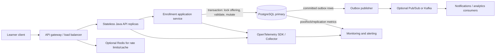

# Future Enhancements: Production Distributed Service

> **Architecture assessment only.** This document describes possible future evolution; it does not change the approved Java CLI, requirements, HLD, LLD, POM, or implementation. Production traffic, availability, latency, recovery targets, and budget have not been supplied. Any example targets below are explicitly illustrative and require business approval.

## 1. Executive Summary

The current application is a useful correctness baseline for one course offering in one JVM. It applies enrollment and waitlist rules in `CourseEnrollmentService`, protects state transitions with one `ReentrantLock`, builds immutable `CourseOfferingState` values, and publishes them through an `AtomicReference` in `InMemoryOfferingStore`. That provides serialized state changes and failure atomicity only while all callers use the same service instance and process.

A production distributed service needs one durable authority shared by every replica. The recommended first production architecture is a stateless Java REST service with PostgreSQL as the source of truth. A transaction that locks the offering row should serialize enrollment, capacity checks, waitlist assignment, drop, and promotion. Database uniqueness constraints backstop duplicate membership. Persist idempotency keys and outbox events in the same transaction when those requirements are added.

Redis, a message broker, Kubernetes, and multi-region active-active writes are not prerequisites for correctness. Add them only for a defined need: Redis for measured caching or edge rate limiting, a broker for asynchronous downstream work, and Kubernetes/GKE if its operational flexibility is worth the platform cost. A managed container platform such as Cloud Run can be a simpler first deployment for a stateless API.

The first priorities are durable transactional state, distributed concurrency correctness, authentication/authorization, bounded overload behavior, and observability. Defer asynchronous enrollment, multi-region writes, and sophisticated autoscaling until product requirements and measured load justify them.

## 2. Current Architecture and Its Guarantees

| Current component | Confirmed behavior | Boundary of guarantee |
|---|---|---|
| `CourseEnrollmentService.enroll` and `.drop` in `src/main/java/com/courseenrollment/service/CourseEnrollmentService.java` | Validates learner IDs, handles duplicate membership, checks the fixture, computes enrollment or drop/promotion, and returns typed result records. | Business rules are applied only for callers using this in-process service. There is no network/API boundary. |
| `CourseEnrollmentService.offeringLock` | One `ReentrantLock` is acquired before a state-dependent operation and released in `finally`. `getStatus` uses the same lock. | Serializes callers using this service instance in this JVM. It is not fair-configured, durable, or shared with another process. |
| `CourseOfferingState` in `src/main/java/com/courseenrollment/domain/CourseOfferingState.java` | Copies the enrollment set and waitlist list and exposes unmodifiable collections. Constructor validates positive capacity, enrollment not over capacity, no duplicate waitlist IDs, and no overlap between active memberships. | Immutable in-memory snapshots, not persistence or cross-process consistency. |
| `InMemoryOfferingStore` in `src/main/java/com/courseenrollment/store/InMemoryOfferingStore.java` | Holds the current snapshot in an `AtomicReference`; `publishState` performs one atomic reference replacement and rejects a capacity change. | Atomic reference replacement is local to this process. State is lost on process restart. Direct public store calls bypass the service lock; the supported path is through the service. |
| `EligibilityFixture` in `src/main/java/com/courseenrollment/store/EligibilityFixture.java` | In-memory map distinguishes unknown IDs from known eligible/ineligible learners. Tests can change known learner eligibility between service calls. | No learner/course completion system, durable source, or synchronized external eligibility integration. |
| `CourseEnrollmentCli` in `src/main/java/com/courseenrollment/cli/CourseEnrollmentCli.java` and `Main` in `src/main/java/com/courseenrollment/cli/Main.java` | `CourseEnrollmentCli.runSession` parses interactive commands, delegates business operations, and formats results. `Main.main` starts it with four eligible demo IDs and capacity 3. | One local process/session; no remote clients, identity, persistence, or operational telemetry. |

Current success/failure guarantees are valuable and should be retained: a state transition is built as a candidate and published once; prerequisite evaluation failure before publication leaves the snapshot unchanged; the service lock is released in `finally`; an output failure after publication does not undo committed state. Current JUnit tests cover these properties and concurrent calls against one service instance; they do not establish behavior across JVMs or hosts.

## 3. Current Limitations

- **Volatile single-process state:** `AtomicReference` and the fixture disappear on restart. A second process starts empty and has a different course state.
- **No distributed serialization:** Each `CourseEnrollmentService` has its own lock. Separate containers can both observe the last seat and enroll different learners.
- **One lock is a serial lane:** In one service instance, all state-dependent calls for the one offering wait behind one non-fair lock, including status reads. Long prerequisite evaluation or snapshot copying extends the critical section.
- **No admission or request queue policy:** A future HTTP server's worker queue could grow without a configured bounded queue, timeout, or overload response. The current CLI reads one line at a time and does not model this.
- **No identity boundary:** Any local CLI user can submit any learner ID. There is no authentication or ownership authorization.
- **Fixture is not production eligibility:** The map is a test/demo fixture, not an authoritative learner transcript or prerequisite service.
- **No production operations layer:** There are no structured application logs, metrics/traces, health probes, deployment automation, backups, recovery plan, or SLOs.
- **Status and result delivery are local:** The status read is coherent under the same process lock. There is no API contract, retry protocol, idempotency key, or durable record of a committed response.

## 4. Scalability and Concurrency Analysis

### A. Concurrent requests within one application instance

For the current CLI, one input loop processes commands sequentially. If the service is called by many threads (for example, after adding HTTP), the offering-level `ReentrantLock` serializes every enrollment, drop, and status call from before the snapshot read until after publication. This preserves the final-seat invariant within that instance, but throughput for that offering is bounded by the slowest serialized operation. Snapshot copies are O(E + W); waitlist membership/position scans and promotion scans are O(W), as stated in `docs/LLD.md`.

With hundreds or thousands of simultaneous requests, callers block waiting for the lock. The current lock is non-fair by default; Java does not promise FIFO acquisition, so request scheduling can have tail latency and a caller could wait longer than others. The current CLI creates no HTTP thread pool, but a server wrapper could exhaust request workers while they block. An unbounded upstream queue turns contention into memory use, long response times, and timeouts; client retries can amplify the queue.

**Business impact:** At a registration opening, eligible learners may receive slow responses or time out even though the state remains correct inside the single process. High lock contention can starve unrelated status reads and, once more offerings exist, one global lock would unnecessarily serialize independent courses.

**Recommended changes if concurrency grows:** keep the consistency scope per offering; measure wait time and hold time before changing lock policy; bound server workers and request queues; use timeouts and explicit overload responses; validate/evaluate immutable input before acquiring a narrow write lock where correctness permits; do not perform remote I/O inside a lock. In a persistent service, move correctness to a database transaction and use multiple application replicas rather than relying on a JVM lock.

**Alternatives:**

- A fair JVM lock can reduce acquisition starvation but may lower throughput and still coordinates only one process.
- `ReadWriteLock` can allow concurrent status reads but complicates upgrades and does not help write contention; use only if profiling shows status-read contention and immutable snapshots can be safely observed.
- Per-offering locks improve throughput across different offerings, but do not solve the same offering across replicas.
- A bounded executor/queue protects memory and provides overload behavior; it does not increase the serialized service's underlying capacity.

Validate with a repeatable concurrent test for a single last seat, duplicate requests, and mixed enrollment/drop. Record throughput, lock wait/hold distributions, tail latency, rejected work, and invariant violations under representative load. The existing latch tests verify correctness, not a production capacity target.

## 5. Multi-Instance Consistency

### B. Multiple application containers or replicas

If two requests reach separate containers, each gets a separate `ReentrantLock` and an independent `InMemoryOfferingStore`. Both can observe one remaining seat, publish different snapshots, and return `ENROLLED`; afterward, each replica continues from its own view. A load balancer does not make process memory authoritative, and sticky sessions only hide the problem until routing changes or a container restarts.

**Recommended source of truth:** PostgreSQL (or an equivalent transactional relational database) shared by stateless application replicas. In one transaction, lock the single offering row, inspect active membership and capacity, evaluate locally available prerequisite facts, write enrollment or waitlist membership, and commit. Use a unique `(offering_id, learner_id)` constraint for active registration, plus a unique waitlist sequence per offering. The database, not the load balancer or a cache, decides the winner for the final seat.

**Concurrency approaches:**

| Approach | Benefits | Trade-offs / use |
|---|---|---|
| Pessimistic row lock (`SELECT ... FOR UPDATE`) on the offering | Maps directly to one-offering serialized invariant; straightforward atomic drop+promotion; easy to reason about. | Hot course serializes at the DB row; transaction duration and deadlocks must be controlled. Recommended first migration. |
| Optimistic version / compare-and-swap update | Avoids holding a lock during low-contention work; stale writes fail explicitly. | Hot enrollment openings create retries/aborts; all membership/capacity invariants must be rechecked after a conflict. Good when conflict rates are low and bounded retries work. |
| Serializable transactions | Database detects serialization anomalies and aborts conflicting transactions. | More retries, vendor-specific behavior, and possible reduced throughput during spikes. Useful as an additional guarantee if measured and tested. |
| Redis/distributed lock | Can coordinate a lease across processes and is useful for some coordination workflows. | Lease expiry, pauses, partitions, and failover can permit stale owners unless fencing is used. Redis is not a substitute for DB constraints/transactions. Not recommended as the authority for enrollment capacity. |
| Atomic conditional database update / reservation counter | Can make seat allocation a narrow atomic operation. | Enrollment plus queue ordering, duplicate membership, promotion, and response idempotency still require coordinated transaction semantics. Consider only after measurement. |

Use a local lock only as an optimization inside one process, never as the correctness boundary once multiple replicas exist. Keep PostgreSQL constraints and transactions sufficient to prevent overbooking even if application locking fails.

## 6. High-Traffic and Overload Management

### C. Registration spikes

A popular course opening can receive thousands of requests over a short interval. Horizontal scaling adds API capacity but can increase contention at the one authoritative offering row. The design must protect the database and provide explicit overload responses rather than accepting unlimited work.

Recommended request path:

1. API gateway validates request size/rate, authenticates the caller, and applies per-user/per-offering admission limits.
2. Load balancer routes to stateless service replicas.
3. Service validates syntax and checks request idempotency before starting the state transaction.
4. A bounded application worker pool and connection pool limit concurrent database work. Requests beyond configured capacity receive `429 Too Many Requests` or `503 Service Unavailable` with `Retry-After`, according to policy.
5. The transaction locks the offering row, decides exactly one outcome, commits, then returns the durable result.

Apply exponential backoff with jitter to retryable conflicts and service-unavailable responses. Do not retry validation, unknown learner, or ineligible outcomes automatically. Client retry guidance must avoid synchronized retry storms. Rate limits need business approval: an excessively low per-course limit can unfairly reject legitimate learners, while a global limit does not protect a single hot offering.

**Synchronous vs asynchronous:** Keep enrollment synchronous initially because the caller needs a definitive `ENROLLED`, `WAITLISTED`, or rejection result and capacity/queue state must be committed before acknowledgement. Asynchronous processing is appropriate for notifications, analytics, audit export, or an explicitly approved “request accepted/pending” registration model. If the latter is adopted, return `202 Accepted` with a durable request ID and expose status; never imply enrollment before the transaction commits. Use a transactional outbox for committed events rather than dual-writing database plus broker.

**Idempotency:** Require or support an `Idempotency-Key` for retriable API mutations. Persist `(caller_id, key, request_hash, outcome, response)` with the transaction. Repeating the same key/body returns the stored outcome; reusing the key with a different body returns a conflict. Keep the existing unique learner/offering constraint too; idempotency keys address request retries, not business uniqueness.

Load tests should model a synchronized registration opening, include the final-seat contention path, and observe DB lock waits, pool saturation, tail latency, rate-limit outcomes, and correctness. “10,000 requests” is a scenario to test at a chosen arrival rate; it is not an assumed production capacity or target.

## 7. Persistence and Transaction Design

### D. Relational data and consistency

A production relational schema can begin with three logical tables, adjusted after the eligibility source and course catalog are defined:

```sql
CREATE TABLE course_offerings (
    offering_id       text PRIMARY KEY,
    capacity          integer NOT NULL CHECK (capacity > 0),
    next_waitlist_seq bigint NOT NULL DEFAULT 1,
    version           bigint NOT NULL DEFAULT 0
);

CREATE TABLE learner_eligibility (
    offering_id text NOT NULL REFERENCES course_offerings(offering_id),
    learner_id  text NOT NULL,
    eligible    boolean NOT NULL,
    PRIMARY KEY (offering_id, learner_id)
);

CREATE TABLE registrations (
    offering_id text NOT NULL REFERENCES course_offerings(offering_id),
    learner_id  text NOT NULL,
    status      text NOT NULL CHECK (status IN ('ENROLLED', 'WAITLISTED')),
    queue_seq   bigint,
    PRIMARY KEY (offering_id, learner_id),
    CHECK ((status = 'WAITLISTED') = (queue_seq IS NOT NULL))
);

CREATE UNIQUE INDEX registrations_waitlist_order_uq
    ON registrations (offering_id, queue_seq)
    WHERE status = 'WAITLISTED';
```

The primary key prevents a learner from having two active registrations for the same offering, regardless of status. The partial unique index prevents duplicate queue positions. Capacity is a cross-row invariant, so a `CHECK` constraint cannot enforce it by itself; every mutation must serialize on the offering row or use a rigorously tested conditional-update scheme. Withdrawn/history records can be added later if retention/audit requirements justify a separate history model; do not weaken active uniqueness accidentally.

`learner_eligibility` here represents a local transactional eligibility snapshot, not an assumed transcript system. If eligibility remains owned by a remote service, decide freshness and failure policy before integration. A remote call while holding the offering lock can inflate lock duration and make promotion availability depend on that service. One option is to persist the eligibility facts needed for the decision with a source/version timestamp and refresh them through a defined process; another is a synchronous remote validation before the database transaction with clearly documented stale-data trade-offs. Neither is chosen by the current assignment.

#### Capacity-safe enrollment transaction

```sql
BEGIN;

-- Serializes capacity and queue decisions for this offering across replicas.
SELECT capacity, next_waitlist_seq
FROM course_offerings
WHERE offering_id = :offering_id
FOR UPDATE;

-- Existing membership wins before eligibility is rechecked.
SELECT status, queue_seq
FROM registrations
WHERE offering_id = :offering_id AND learner_id = :learner_id;
-- If found, return existing state/position without changing it.

SELECT eligible
FROM learner_eligibility
WHERE offering_id = :offering_id AND learner_id = :learner_id;
-- Missing row => UNKNOWN_LEARNER; false => INELIGIBLE.

SELECT count(*)
FROM registrations
WHERE offering_id = :offering_id AND status = 'ENROLLED';

-- If count < capacity: INSERT ENROLLED. Otherwise insert WAITLISTED
-- using next_waitlist_seq, then increment that sequence on the locked row.
-- Unique constraints remain the final duplicate guard.
COMMIT;
```

The transaction lock makes the read/check/write decision atomic across service replicas. Keep transactions short. A unique-key conflict should be handled by re-reading and returning the current membership when it is a duplicate race, not by returning an unexplained server error. The database remains the authority if a local process lock or cache disagrees.

#### Version-column optimistic locking alternative

If pessimistic locking is a measured bottleneck, read `version`, build a candidate decision, then perform a conditional update in the same transaction:

```sql
UPDATE course_offerings
SET version = version + 1,
    next_waitlist_seq = :next_waitlist_seq
WHERE offering_id = :offering_id
  AND version = :observed_version;
```

Require exactly one updated row before committing membership writes; zero rows means stale state and the transaction must retry the full decision a bounded number of times. Capacity, uniqueness, eligibility, and queue order must be recomputed after every retry. A version column alone does not enforce capacity if writers do not condition all related writes on the version update.

#### Atomic drop and FIFO promotion

```text
BEGIN
lock offering row FOR UPDATE
verify learner is actively ENROLLED; otherwise return UNKNOWN_LEARNER or NOT_ENROLLED without mutation
mark/delete dropped active registration within transaction
read WAITLISTED registrations ordered by queue_seq ascending
for each waiter in order:
    read current local eligibility
    if eligible:
        update that registration to ENROLLED and clear queue_seq
        stop scanning
    else:
        retain the registration and queue_seq
commit once
```

If eligibility evaluation or any database operation fails before commit, roll back the drop and promotion together. If no eligible waiter is found, commit the drop and leave capacity open. Do not automatically promote on eligibility changes or rescan on unrelated enrollment, per the approved business rule. The offering-row lock defines the serialization boundary; do not use `SKIP LOCKED` if it can bypass an earlier candidate and violate strict FIFO selection.

#### Retries, idempotency, and delivery

A timeout after commit leaves the client uncertain; the server cannot infer that the client did not receive the response. Persist an idempotency key and its outcome in the same transaction as the enrollment/drop. A retry with that key returns the committed result. This provides one business effect per idempotency key, not exactly-once network delivery. If a committed operation must publish an event, write an outbox row in the same transaction and publish it asynchronously; consumers must deduplicate event IDs because broker delivery is normally at-least-once.

Crash recovery comes from database transaction rollback for uncommitted changes, WAL/durable commit for committed changes, constraints for uniqueness, and idempotent replay for uncertain client retries. Verify actual durability/failover guarantees with the selected database service and configuration.

## 8. High Availability

### E. Application and database availability

A stateless application replica can be restarted or replaced without losing registration state once the database is authoritative. Place replicas behind a load balancer; use readiness to remove instances that cannot serve traffic, and liveness only to recover a stuck process. A transient database failure should generally make an instance unready or return a bounded `503`; liveness should not continuously restart a healthy process merely because a dependency is unavailable.

The database remains a critical dependency. Use a managed high-availability PostgreSQL deployment (for example, Cloud SQL HA) or equivalent: synchronous/managed failover within a region where supported, backups, monitored replication, and tested client reconnect behavior. Consider connection-pool reset/retry behavior carefully; a retry must be idempotent and must not create another enrollment. Avoid one shared in-process store per replica.

Availability is a business decision. Candidate SLIs include successful enrollment decision availability, API latency, error rate by outcome, and promotion completion delay. Any SLO (for example, an illustrative 99.9% monthly availability or p95 latency target) is a proposal only, not a committed SLA. Higher availability typically increases cost and operational complexity and may require multi-zone databases, spare capacity, and on-call response.

## 9. Disaster Recovery

### F. Region outage, backup, and recovery

- **RPO (Recovery Point Objective):** maximum acceptable amount of committed data that may be lost after a disaster.
- **RTO (Recovery Time Objective):** maximum acceptable time to restore service after a disaster.

The business has not specified either value. For planning discussion only, an illustrative target might be RPO ≤ 5 minutes and RTO ≤ 1 hour; these are not approved requirements and must not be used as an operational commitment without validation.

Start with automated encrypted backups and point-in-time recovery to a separate failure domain, then prove restores regularly. A regional outage may require restoring/replicating to a secondary region and changing application routing. The recovery process must preserve the identity of the authoritative writer and prevent the old region from accepting writes after failover.

- **Active-passive:** one write region and a replicated standby. Simpler consistency and less risk of simultaneous capacity decisions; failover may involve measurable RTO and some asynchronous-replication RPO.
- **Active-active writes:** lower geographic latency but requires global uniqueness, conflict resolution, ordering, and capacity serialization across regions. It can violate FIFO or overbook if two regions independently grant the last seat. Defer unless business latency/availability requirements justify global coordination; otherwise use a single fenced writer per offering/region.

After failover, reconcile the last durable database state, preserve idempotency records, and keep the old primary fenced. Run planned DR drills: restore a backup, promote a replica, replay outbox events idempotently, verify capacity and uniqueness, and measure achieved RTO/RPO. Do not advertise targets until drills validate them.

## 10. Observability and SLOs

### G. Logs, traces, metrics, and alerts

Use structured JSON logs with request/correlation ID, offering ID (if cardinality is bounded), operation, outcome, duration, and trace ID. Do not log full learner PII or secrets. Keep learner IDs out of metric labels; high-cardinality labels can overwhelm Prometheus and leak data. For audit, record identity and action in a controlled audit store with access and retention policy.

Instrument Spring Boot with Micrometer and OpenTelemetry; export OTLP traces/metrics to an OpenTelemetry Collector or managed equivalent. Example metric names:

- `course_enrollment_requests_total{outcome}` (bounded outcomes such as `enrolled`, `waitlisted`, `duplicate`, `ineligible`, `unknown`, `internal_error`).
- `course_enrollment_decision_duration_seconds` histogram.
- `course_waitlist_depth` gauge, labeled only by a bounded offering grouping if the number of offerings is manageable; otherwise aggregate or query details from the database.
- `course_promotion_duration_seconds` histogram and `course_promotion_attempts_total{outcome}`.
- `course_prerequisite_evaluation_failures_total`.
- `http_server_requests_seconds` from the web framework, plus JVM, executor, database pool, and database lock/transaction metrics.

Prometheus alert examples (thresholds are illustrative pending SLO approval):

```promql
# Internal-error ratio above an illustrative 1% for 10 minutes.
sum(rate(course_enrollment_requests_total{outcome="internal_error"}[5m]))
/
sum(rate(course_enrollment_requests_total[5m])) > 0.01

# Database connection pool is persistently saturated.
hikaricp_connections_pending > 0
```

Define SLIs before SLOs: enrollment decision success rate (excluding expected business rejections), request latency, promotion completion latency, and service availability. Choose windows, targets, and error budgets with product/operations. Alert on user impact and fast error-budget burn, not every transient lock wait. Dashboards should correlate enrollment outcomes, waitlist depth, lock/database latency, pool saturation, JVM thread usage, and deployment changes.

## 11. Security and Abuse Prevention

- Authenticate learners using an established identity provider (OIDC/OAuth2 or equivalent); authorize enrollment/drop against the authenticated subject, not merely a caller-supplied learner ID.
- Validate command/API syntax, learner ID format, request size, and allowed operation before business logic. Keep service-boundary checks even if the gateway validates.
- Use gateway and application rate limits by authenticated identity and offering; protect status and error endpoints as well as mutations. Distinguish abuse control from course policy so legitimate users are not silently reordered.
- Emit audit events for enrollment, waitlisting, dropping, promotion, and administrative changes; minimize and protect personal data and apply retention rules.
- Use TLS in transit, managed encryption at rest, least-privilege database/service identities, secrets manager, dependency and image scanning, and routine patching.
- Never expose stack traces, fixture contents, SQL, tokens, or internal identifiers in client error output. Avoid learner IDs in metrics; use protected logs/audit only where necessary.

Authentication, authorization, privacy, and audit are not current CLI features; they become mandatory design inputs before exposing a production endpoint to learners.

## 12. Deployment and CI/CD Strategy

### H. Release and runtime operations

Containerize the stateless application with a minimal Java 17+ runtime image and non-root user. Pin dependencies/base image and scan both. Choose deployment platform by operational needs: Cloud Run can reduce cluster operations for a modest stateless REST service; GKE/Kubernetes offers more control for custom scaling/networking but adds cluster, upgrade, policy, and on-call burden.

For Kubernetes/GKE, use readiness for traffic eligibility and liveness for process health; use startup probe if JVM/application initialization is slow. Configure bounded CPU/memory, graceful termination, request timeouts, worker and DB-pool limits, and HPA based on validated saturation signals (not CPU alone). For Cloud Run, equivalent concurrency, max-instance, startup, and health settings still need explicit bounds.

CI/CD stages should include: compile; unit/integration tests; concurrency/transaction tests against PostgreSQL; static analysis; dependency and container vulnerability scans; secret scan; image build; migration compatibility checks; staging smoke/acceptance tests; controlled canary/rolling rollout; and rollback verification. Keep schema changes backward compatible across old/new application versions using expand-migrate-contract. Run migrations once through a controlled job, not independently at every replica startup.

Rolling deploys are appropriate for compatible stateless releases. Canary/blue-green is useful for risky business-rule or schema changes if metrics can detect regressions. Use feature flags for reversible behavior exposure, not to bypass database invariants. Rollback must account for already-applied schema changes and committed requests; do not assume reverting application binaries reverses data.

## 13. Proposed Production Architecture

### Recommendation

Use a modular Java service with a thin REST adapter, domain/application service, PostgreSQL transaction boundary, and an outbox for any asynchronous downstream events. Begin with one region and one authoritative writer. Keep prerequisite facts locally transaction-readable until a specific eligibility integration is approved. This preserves the current business rules while moving correctness from process memory to the database.

- **REST/API adapter:** authentication, authorization, request/result mapping, syntax validation, correlation IDs, and HTTP status mapping. No queue/capacity rules.
- **Enrollment application service:** applies duplicate, eligibility, capacity, waitlist, drop, and promotion decisions inside one transaction per offering.
- **PostgreSQL:** source of truth for offering, eligibility facts, active registrations, queue order, idempotency outcomes, and outbox records. Unique constraints and row locks backstop service decisions.
- **API gateway/load balancer:** TLS termination, identity integration, request limits, coarse rate limiting, routing, and overload response.
- **Optional Redis:** use only for measured cache/rate-limit or ephemeral coordination needs. Never treat cached enrollment counts or Redis locks as the authoritative capacity guarantee.
- **Optional Kafka/Pub/Sub:** publish committed outbox events for notifications, analytics, or audit exports. Not in the synchronous decision path.
- **OpenTelemetry Collector and monitoring:** traces, metrics, and logs to the selected managed or self-hosted backend.
- **Cloud Run or GKE:** deployment choice based on platform constraints; neither changes the database consistency model.



#### Enrollment request flow

```mermaid
sequenceDiagram
    actor Learner
    participant Gateway as API gateway
    participant API as Stateless enrollment API
    participant Service as Enrollment service
    participant DB as PostgreSQL

    Learner->>Gateway: POST enroll + idempotency key
    Gateway->>Gateway: Authenticate, authorize, rate limit
    Gateway->>API: Forward bounded request
    API->>API: Validate learner ID and request ownership
    API->>Service: enroll(offeringId, learnerId, idempotencyKey)
    Service->>DB: BEGIN; lock offering row
    Service->>DB: Check idempotency result and active membership
    alt Existing membership or replayed key
        DB-->>Service: Existing durable result
    else New request
        Service->>DB: Check local eligibility and enrolled count
        alt Eligible and seat available
            Service->>DB: Insert ENROLLED registration
        else Eligible and full
            Service->>DB: Insert WAITLISTED registration with queue sequence
        else Unknown or ineligible
            Service->>DB: Prepare no-change result
        end
        Service->>DB: Persist idempotency outcome and optional outbox event
        Service->>DB: COMMIT
    end
    Service-->>API: Committed enrollment outcome
    API-->>Gateway: HTTP result
    Gateway-->>Learner: Enrollment result
```

1. Gateway authenticates, applies request bounds, and forwards a request with an idempotency key.
2. API validates shape and authorizes `learnerId` against the authenticated subject.
3. Service begins transaction and checks the idempotency record. A matching completed key returns the stored result; a mismatched request hash is rejected.
4. Lock the offering row; check existing active membership first; distinguish unknown/ineligible from eligible using transaction-readable eligibility data.
5. Count enrolled memberships; insert `ENROLLED` if capacity remains, otherwise append `WAITLISTED` with the next sequence. Constraints protect uniqueness.
6. Persist outcome/idempotency record and optional outbox event in the same transaction; commit; then return the exact outcome.

#### Drop and promotion request flow

```mermaid
sequenceDiagram
    actor Learner
    participant Gateway as API gateway
    participant API as Stateless enrollment API
    participant Service as Enrollment service
    participant DB as PostgreSQL

    Learner->>Gateway: POST drop + idempotency key
    Gateway->>Gateway: Authenticate, authorize learner ownership, rate limit
    Gateway->>API: Forward bounded request
    API->>Service: drop(offeringId, learnerId, idempotencyKey)
    Service->>DB: BEGIN; lock offering row
    Service->>DB: Check idempotency and active enrollment
    alt Unknown or not enrolled
        DB-->>Service: No-change outcome
    else Enrolled
        Service->>DB: Stage drop in transaction
        loop Waiters ordered by queue sequence
            Service->>DB: Check current local eligibility
            alt Ineligible
                Note over Service,DB: Retain queue row; continue scanning
            else First eligible waiter
                Service->>DB: Promote learner and stop scan
            end
        end
        opt No eligible waiter found
            Note over Service,DB: Commit drop; leave seat open
        end
        Service->>DB: Persist outcome and optional outbox event
        Service->>DB: COMMIT entire drop/promotion transition
    end
    Service-->>API: Committed drop outcome
    API-->>Gateway: HTTP result
    Gateway-->>Learner: Drop/promotion result

    Note over Service,DB: Eligibility or transaction failure before commit rolls back both drop and promotion.
```

1. Authenticate and authorize the learner as owner of the requested enrollment; begin transaction and lock the offering row.
2. Verify active enrollment. Unknown/non-enrolled results make no state change.
3. Stage the drop, scan waitlisted rows in `queue_seq` order, and evaluate current eligibility from the local transactional source.
4. Skip but retain ineligible rows; promote only the first eligible row. If none qualifies, commit the drop and leave capacity open.
5. Write idempotency outcome/outbox event, commit once. Any pre-commit failure rolls back drop and promotion together.

**Consistency boundary:** offering row lock plus transaction/constraints. The load balancer can route any request to any replica because no replica-local state decides enrollment. **Asynchronous work:** send post-commit notifications/analytics through outbox events; do not asynchronously decide a seat unless the product explicitly accepts pending outcomes instead of immediate decisions.

### Illustrative implementation guidance (not current code)

**Capacity transaction:**

```sql
BEGIN;
SELECT capacity, next_waitlist_seq
FROM course_offerings
WHERE offering_id = :offering_id
FOR UPDATE;

-- Check existing (offering_id, learner_id), then eligibility.
-- Count ENROLLED rows while holding the offering lock.
-- Insert ENROLLED if count < capacity; otherwise insert WAITLISTED
-- with next_waitlist_seq and increment it on the locked offering row.
COMMIT;
```

**Optimistic version alternative:**

```sql
UPDATE course_offerings
SET version = version + 1
WHERE offering_id = :offering_id AND version = :observed_version;
-- Require one updated row. On zero, retry the complete decision in a new transaction.
```

**Idempotent request handling (pseudocode):**

```text
BEGIN
lookup or claim (caller_id, idempotency_key)
if completed key exists:
    require same request hash; return stored response
lock offering and compute the business decision
write registration change + response record + outbox event
COMMIT
return committed response
```

A database commit followed by a lost HTTP response is resolved by replaying the same key and returning the stored result. This is one business effect per key, not exactly-once network delivery.

**FIFO promotion (pseudocode):**

```text
BEGIN; lock offering row
verify enrolled membership; stage removal
for waiter ordered by queue_seq:
    check local current eligibility
    if false: retain row and continue
    update first eligible row to ENROLLED; clear queue_seq; stop
if no eligible row: commit with seat open
write result/outbox and COMMIT
```

**API rate limiting (illustrative pseudocode):**

```text
key = authenticatedCaller + offeringId
if tokenBucket(key).allow(configuredRate, configuredBurst):
    continue
else:
    return 429 with Retry-After
```

Set rate and burst only after traffic and fairness requirements are known. Learner IDs are not metric labels or global limiter keys without an approved privacy design.

**Metrics/tracing (illustrative Spring/Micrometer shape):**

```java
Counter.builder("course_enrollment_requests_total")
    .tag("outcome", boundedOutcome)
    .register(registry)
    .increment();

Timer.builder("course_promotion_duration")
    .publishPercentileHistogram()
    .register(registry)
    .record(promotionDuration);
```

Create spans around API request and transaction, attach trace/correlation ID, operation, and bounded result category. Never tag spans/metrics with learner IDs. Exact Java instrumentation and naming should follow the selected Micrometer/OpenTelemetry conventions.

**Kubernetes probes (illustrative only):**

```yaml
startupProbe:
  httpGet: { path: /actuator/health/liveness, port: 8080 }
  failureThreshold: 30
  periodSeconds: 5
readinessProbe:
  httpGet: { path: /actuator/health/readiness, port: 8080 }
  periodSeconds: 10
livenessProbe:
  httpGet: { path: /actuator/health/liveness, port: 8080 }
  periodSeconds: 20
```

Probe paths/configuration are examples; readiness should reflect whether the instance can serve safely, and liveness should detect a stuck process rather than transient database outage loops.

## 14. Failure Scenarios and Recovery Strategies

| Failure scenario | Expected behavior and consistency | Recovery/validation |
|---|---|---|
| 1. Two replicas request the last seat simultaneously | Both serialize on the authoritative offering row/transaction. One enrolls; the other observes full capacity and is waitlisted. Unique constraints prevent duplicate active membership. | Concurrency integration test against PostgreSQL; assert capacity and unique membership under repeated races. |
| 2. Database commits enrollment but client times out | Do not assume rollback. Retry with same idempotency key returns stored committed result; no second enrollment is created. | Fault-inject response timeout after commit; verify replay and exact stored response. |
| 3. Application crashes after enrollment commit | Committed row remains authoritative; uncommitted transaction is rolled back by DB. Client retry uses idempotency key. | Kill process around commit boundary; restart replicas; verify registration and invariant. |
| 4. Message/outbox event is delivered twice | Registration is already committed once; consumer deduplicates by event ID and performs idempotent work. | Redeliver event; assert one downstream effect and retained outbox state. |
| 5. A course receives 10,000 requests in a short interval | Gateway and bounded pools admit configured work; excess receives 429/503. Accepted requests serialize at the course row; no overbooking. | Spike test using approved arrival shape; verify queue bounds, rejection behavior, DB saturation, and invariants. |
| 6. Eligibility service becomes slow/unavailable | Avoid remote calls inside the offering DB lock. If eligibility is local/snapshotted, continue according to freshness policy; if it is required synchronously and unavailable, fail closed with retryable error and no mutation. | Dependency fault tests, stale-fact policy verification, latency/availability dashboards. |
| 7. Database primary fails during promotion | In-flight transaction either rolls back or is durable on new primary; client may be uncertain and retries idempotently. No partial drop/promotion. | HA failover drill during promotion; verify transaction state, fencing, and invariants. |
| 8. Deployment occurs while requests are in flight | Graceful shutdown stops accepting new work, drains within a bound, and lets committed transactions finish; retries use idempotency. Schema remains compatible with old/new versions. | Rolling deploy under traffic; terminate instance mid-request; verify no lost/duplicated effect. |
| 9. Region outage occurs during enrollment | Active-passive routing sends writes only to promoted/fenced writer. During failover, return bounded unavailable rather than accept writes in two regions. | DR drill; test split-brain prevention, RTO/RPO measurement, and duplicate protection. |
| 10. Client repeatedly retries a drop | Same idempotency key returns original committed response; without it, subsequent attempt receives `NOT_ENROLLED` with no extra promotion. | Retry storm test; check rate limiting, no repeated promotion, and auditable outcomes. |
| 11. Database connection pool saturates | Bounded requests time out/reject before an unbounded worker queue forms; no local fallback enrollment decision. | Saturation test; validate 503/Retry-After, pool recovery, and alerting. |
| 12. Transaction deadlock or serialization abort | Database aborts the whole operation; service retries only known retryable SQL states with bounded attempts and jitter, then returns retryable error. No partial state. | Inject deadlocks/conflicts; verify full transaction retry and no duplicate membership. |
| 13. Eligibility lookup throws during promotion | Transaction rolls back staged drop and all promotion changes; client receives generic internal/retryable outcome. | Inject fixture/database failure and assert original state after rollback. |
| 14. Old region resumes after failover | Fencing prevents old writer from accepting mutations; never rely only on DNS or a lease that can expire unnoticed. | DR split-brain test, verify writer epoch/primary fencing and unique constraints. |

## 15. Current vs Future Comparison

| Area | Current implementation | Limitation | Future enhancement | Priority |
|---|---|---|---|---|
| Concurrency | One service-level `ReentrantLock` | JVM-local; non-fair; serializes one offering in one process | Database offering-row transaction lock plus bounded API worker pools | First production correctness change |
| Scalability | One CLI process and one offering | No network or horizontal state sharing | Stateless API replicas behind gateway/load balancer | After durable persistence |
| Persistence | `AtomicReference` snapshot and fixture map | Lost on restart; replicas diverge | PostgreSQL source of truth, backups, migrations | Highest |
| Consistency | Candidate snapshot and atomic local reference swap | Not shared across replicas; public store calls can bypass service lock | DB transactions, unique constraints, idempotency | Highest |
| High availability | None beyond process execution | Process/host loss ends service and loses state | Multiple stateless replicas, managed HA database, health/readiness | After DB migration |
| Disaster recovery | None | No backup, restore, RTO/RPO | Encrypted backups, PITR, tested standby failover | Before production launch |
| Observability | CLI messages and test results | No production signals or alerting | Structured logs, traces, metrics, SLO/error budgets | Before meaningful traffic |
| Security | Learner IDs accepted locally | No authentication/authorization or abuse control | OIDC, owner authorization, gateway limits, audit | Required before public API |
| Deployment | Local Maven/Java execution | No repeatable runtime/release/rollback | Container CI/CD and Cloud Run or GKE | Production launch prerequisite |
| Operational support | Manual local process | No on-call, runbooks, capacity/failure visibility | Alerts, dashboards, runbooks, incident/DR exercises | Before production launch |

## 16. Phased Implementation Roadmap

| Phase | Changes and components | Prerequisites | Benefits | Risks/trade-offs | Tests and acceptance | Effort |
|---|---|---|---|---|---|---|
| **1 — Current CLI baseline** | Preserve Java CLI, immutable snapshots, fixture, service lock, and current tests. Document constraints and run instructions. | Current approved behavior. | Fastest reviewable baseline; good rule reference. | Volatile and single-process; no public access. | Current JUnit suite passes; invariant and failure-recovery tests remain green; manual CLI walkthrough recorded. | Low |
| **2 — Persistent DB and REST API** | Add REST adapter, PostgreSQL schema/migrations, transaction-backed repository/service, authentication contract, idempotency storage, and integration tests. Keep business behavior identical. | Decide identity/eligibility source, API contract, DB ownership, data retention. | Durable authoritative state; usable service boundary. | Schema and migration complexity; new ops costs; transaction behavior needs DB-specific testing. | Migration tests; API contract tests; capacity/unique/FIFO/drop rollback and idempotency tests against PostgreSQL. | High |
| **3 — Multiple stateless replicas** | Deploy several API replicas; DB row locks/constraints own correctness; readiness, graceful shutdown, bounded pools, rate limits, dashboards. | Phase 2 transaction semantics proven. | Horizontal API availability and scale without replica-local state. | Hot offering row remains serial bottleneck; DB capacity/connection pools can saturate. | Multi-instance last-seat and duplicate race tests; kill/restart a replica under requests; prove no overbooking. | Medium-High |
| **4 — High-traffic protection and optimization** | Load tests; tune pool/lock/transaction duration; edge rate limiting, admission controls, retry policy; consider caching non-authoritative data. Async notifications only via outbox/broker if needed. | Representative demand patterns and agreed latency/fairness goals. | Protects DB and improves predictable behavior during spikes. | Limits can reject legitimate demand; Redis/broker add cost/ops and failure modes. | Spike/soak tests; bounded queue and retry-storm tests; prove cache loss cannot violate correctness. | Medium-High |
| **5 — HA, observability, automated deployment** | Multi-zone app/DB, health probes, structured logs, metrics/traces, alerting/SLOs, secure CI/CD, rolling/canary releases, schema expand-contract. | Ops ownership, SLO/error-budget approval, secrets and identity model. | Detectable failures, safe releases, reduced single-zone outage risk. | Managed HA and monitoring cost; alert/runbook burden; schema compatibility required. | Failover and rolling-deploy tests; probe validation; alert exercise; backward/forward migration test. | High |
| **6 — DR and multi-region considerations** | Backups/PITR, secondary region, writer fencing, restore/failover drills; evaluate active-passive first. | Approved RTO/RPO, data residency and region strategy, budget. | Region-level recovery capability. | Replication lag, failover complexity, split-brain risk; active-active is especially expensive/complex. | Restore and region-failover drills; measure approved RTO/RPO; prove no duplicate/over-capacity state. | High |

## 17. Recommended Priorities and Trade-offs

1. **First:** move state and atomic transitions into a relational database transaction before adding replicas. Application replicas without this step would multiply inconsistent in-memory copies.
2. **Next:** add an authenticated REST boundary and idempotency strategy. These define the production caller contract and protect retries after uncertain commits.
3. **Then:** operate multiple stateless replicas with bounded workers, connection pools, and measured overload behavior. Correctness remains at PostgreSQL constraints/transactions.
4. **Before launch:** establish observability, security controls, backups, deploy/rollback practice, and an on-call/runbook owner. Production readiness is operational as well as architectural.
5. **Defer:** Redis as a correctness store, Kafka/Pub/Sub in the enrollment decision path, active-active multi-region writes, and elaborate microservice decomposition. Add each only when a requirement or measured bottleneck pays for its complexity.

A single offering is inherently a serialization hotspot under a strict capacity invariant. More replicas can absorb parsing/authentication and unrelated offerings, but cannot make the final seat concurrently belong to two learners. Avoid optimizing away the transaction that protects the business rule. Cost choices (managed service vs self-managed GKE/PostgreSQL) need an actual budget and support model; no budget is assumed here.

## 18. Assumptions and Open Questions

No production traffic, availability SLA, latency target, infrastructure budget, or recovery objective is set by the current assignment. Candidate numbers mentioned above are illustrative only.

Before production design, answer:

- How many offerings, learners, and eligibility facts are expected?
- What is expected average and peak enrollment requests per second, including opening spikes?
- Is strict FIFO defined by database-accepted order, client timestamp, or another ordering rule under concurrency?
- What consistency guarantees are required for enrollment and status reads?
- What enrollment response latency and overload behavior are acceptable?
- What is the availability SLA and measurement window?
- What are approved RTO and RPO values?
- Is the deployment single-region or multi-region, and is active-passive sufficient?
- Which identity provider is authoritative, and how is learner-to-account ownership established?
- Where do prerequisite facts come from, how fresh must they be, and what happens if that source is unavailable?
- Is asynchronous enrollment confirmation acceptable, or must every request return a committed decision synchronously?
- What audit, privacy, retention, data residency, and deletion requirements apply?
- What infrastructure/operations budget and on-call support are available?
- Which managed platform is preferred: Cloud Run, GKE, or another equivalent?

Until these are answered, a single-region PostgreSQL-backed service with synchronous enrollment decisions, stateless replicas, transactional outbox for optional side effects, and explicit overload controls is the recommended production starting point—not a claim that the current assignment needs that infrastructure.
