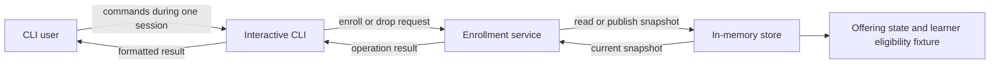
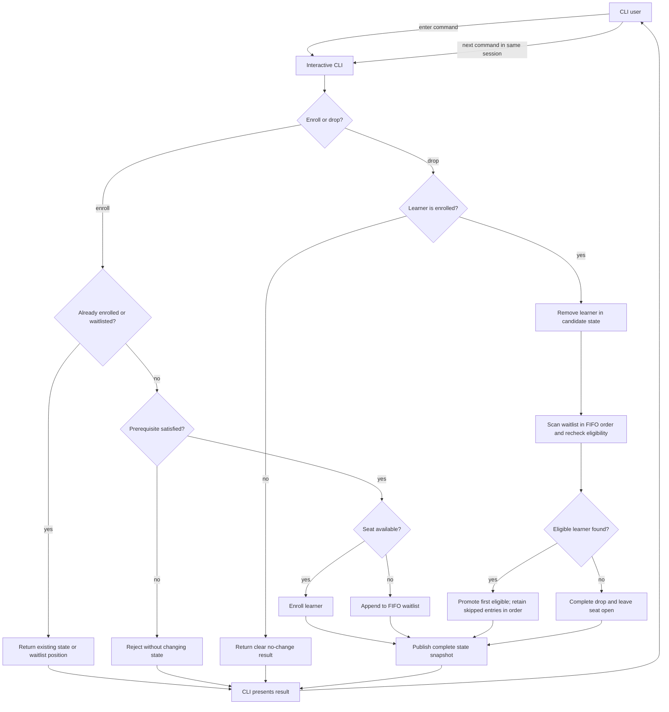

# High-Level Architecture

## Purpose and Scope

This document proposes the logical architecture for the selected Java CLI application with in-memory storage. [`requirement.md`](../requirement.md) is the source of truth for behavior. The application handles one course offering only; this design does not add an HTTP API, database, frontend, or deployment infrastructure.

The design keeps the runtime to three components: CLI, application service, and in-memory state store. Enrollment, prerequisite validation, capacity decisions, waitlist ordering, and promotion stay together in the application service because they are one small set of related business transitions. The store provides a controlled way to access and publish state, not a second home for business rules. The CLI remains active for multiple commands in one application session.

## Component Diagram



The service applies the prerequisite rule using the small in-memory learner eligibility fixture held with the store's data. The fixture is test-configurable and is not managed through additional CLI commands.

## Overall User Flow

The decisions in this flow are handled by the enrollment service. The CLI only dispatches commands and presents results. The user can repeat the flow for multiple commands until ending the interactive session.



## Components and Dependencies

| Component | Responsibility | Depends on |
|---|---|---|
| **Command-line interface (CLI)** | Starts an interactive session, reads multiple commands and learner identifiers, performs basic syntax/argument checks, calls the application service, and formats each result. It contains no enrollment, capacity, prerequisite, or promotion decisions. | Course enrollment service |
| **Course enrollment service** | Implements the use cases and business rules: duplicate-state handling, prerequisite checks, capacity checks, waitlist insertion and position reporting, drop validation, eligibility rechecks during promotion, and the skip-but-retain policy. Computes a complete next offering state before publishing it. | CLI request values; in-memory offering store and its eligibility fixture |
| **In-memory offering store** | Initializes and owns the one offering and the learner eligibility fixture; exposes controlled snapshot read/replacement operations. The sample offering has positive capacity, starts empty, and uses capacity 3 for the CLI demonstration. Tests can initialize other capacities and eligibility fixtures. It does not decide eligibility, promotion order, or enrollment outcomes. | Java in-memory data structures; called by the service |
| **Offering state and eligibility fixture (data, not separate services)** | Offering state holds capacity, enrolled learner identifiers, and waitlist entries in accepted-request order. The small fixture supplies learner prerequisite eligibility facts for service checks; tests can vary those facts without a learner-management CLI feature. | No runtime dependency |

No separate controller, repository interface hierarchy, policy engine, transaction manager, or domain framework is proposed. Those would add indirection without helping this one-offering slice.

## Responsibilities by Business Concern

- **CLI interaction:** The CLI remains active for multiple commands in one application session, maps each command to a service call, and displays its result. A malformed command is rejected before changing application state.
- **Enrollment:** The service first returns an existing enrollment or waitlist state for a duplicate request. Otherwise it checks prerequisite eligibility, then enrolls if capacity remains or appends the learner to the waitlist.
- **Prerequisite validation:** The service applies the stated eligibility rule using the in-memory fixture before a new enrollment or waitlist entry and rechecks eligibility when considering a learner for promotion. Tests can change fixture eligibility directly; the CLI has no learner-management operation. The service skips an ineligible learner for that promotion while retaining the learner's original relative queue position.
- **Capacity management:** The service compares enrolled count with the offering capacity and only commits a state with enrolled count at or below capacity. A drop that has no eligible promotion leaves the seat open.
- **Waitlist handling and promotion:** The service appends accepted waitlist requests to the end of the ordered queue. On a drop, it scans in order, promotes the first currently eligible learner, and retains skipped ineligible entries in their relative order.
- **State access:** The store owns a current immutable snapshot. The service reads it and constructs a complete next snapshot rather than exposing or incrementally mutating the store's collections.

## State Consistency and Concurrency

The enrollment service serializes operations for the one offering with one in-process lock, held from reading the current snapshot through publishing the next snapshot. Each operation uses a try/finally-style guarantee: after the lock is acquired, every result and failure path releases it before the service returns a result or propagates a failure. A sequential CLI does not need concurrent-request infrastructure, but the lock also protects check-and-update decisions if service calls overlap. The lock does not coordinate multiple processes.

For each mutation, the service builds a candidate next state locally and asks the store to replace the current snapshot only after all checks and calculations succeed. If an operation fails before publication, the candidate is discarded and the current state remains unchanged. This makes dropping and promotion one consistent transition without adding a transaction framework. Invalid or repeated drops return a clear result and publish no state change. Publication is the commit point: a CLI output failure after successful publication does not roll back the committed state.

## Enrollment Sequence

```mermaid
sequenceDiagram
    actor User
    participant CLI
    participant Service as Enrollment service
    participant Store as In-memory store

    loop Multiple commands in one interactive session
    User->>CLI: enter enroll command
    CLI->>Service: enroll(learnerId)
    Service->>Service: acquire offering lock
    Note over Service: Run transition in try/finally; record an outcome for each branch.
    Service->>Store: read current snapshot
    Store-->>Service: current snapshot
    Service->>Service: check existing enrollment or waitlist entry
    alt already enrolled
        Service->>Service: record existing enrollment result
    else already waitlisted
        Service->>Service: record existing waitlist position
    else new request
        Service->>Service: check prerequisite eligibility
        alt prerequisite not satisfied
            Service->>Service: record ineligible result; make no state change
        else prerequisite satisfied
            Service->>Service: check available capacity
            alt seat available
                Service->>Service: build candidate with learner enrolled
                Service->>Store: publish complete candidate snapshot
                Store-->>Service: state published
                Service->>Service: record enrolled result
            else course full
                Service->>Service: append learner to candidate FIFO waitlist
                Service->>Store: publish complete candidate snapshot
                Store-->>Service: state published
                Service->>Service: record waitlisted result and position
            end
        end
    end
    Note over Service,Store: If processing fails before publication, discard candidate; current state is unchanged.
    Service->>Service: finally release offering lock
    Service-->>CLI: return recorded result or propagate failure
    CLI-->>User: display result
    Note over CLI,Store: CLI output failure after publication does not roll back committed state.
    end
```

### Drop and Promotion Sequence

```mermaid
sequenceDiagram
    actor User
    participant CLI
    participant Service as Enrollment service
    participant Store as In-memory store

    loop Multiple commands in one interactive session
    User->>CLI: enter drop command
    CLI->>Service: drop(learnerId)
    Service->>Service: acquire offering lock
    Note over Service: Run transition in try/finally; record an outcome for each branch.
    Service->>Store: read current snapshot
    Store-->>Service: current snapshot
    Service->>Service: verify learner is enrolled
    alt learner is not enrolled
        Service->>Service: record clear no-change result
    else learner is enrolled
        Service->>Service: remove learner from candidate enrollment
        loop FIFO entries until eligible learner found or queue exhausted
            Service->>Service: recheck next learner eligibility
            alt learner is ineligible
                Note over Service: Retain entry and relative position; continue scan
            else learner is eligible
                Service->>Service: promote learner and remove from candidate waitlist
            end
        end
        alt eligible learner was promoted
            Note over Service: Remaining waitlist order is unchanged
        else no eligible learner was found
            Note over Service: Drop succeeds; seat remains open
        end
        Service->>Store: publish complete candidate snapshot once
        Store-->>Service: state published
        Service->>Service: record successful drop result
    end
    Note over Service,Store: If processing fails before publication, discard candidate; current state is unchanged.
    Service->>Service: finally release offering lock
    Service-->>CLI: return recorded result or propagate failure
    CLI-->>User: formatted result
    Note over CLI,Store: CLI output failure after publication does not roll back committed state.
    end
```

## Why This Separation Fits

The CLI is kept separate so input/output concerns cannot accidentally change business rules, and the application service can be tested without launching an interactive session. Keeping the related rules in one service makes the flow easy to review and avoids splitting a small feature across many classes. Encapsulating state in one store prevents callers from mutating enrollment or queue collections outside the service. Publishing a complete snapshot gives the drop-and-promotion operation a clear consistency boundary without introducing a database or transaction framework. The in-memory eligibility fixture keeps prerequisite changes easy to exercise in tests without expanding the CLI's scope.

## Approved Decisions

1. **Prerequisite fixture:** Use a small in-memory learner eligibility fixture. Tests can vary eligibility directly without adding a learner-management feature to the CLI; the service remains responsible for applying the prerequisite rule.
2. **Offering initialization:** Initialize one predefined offering with a positive capacity and empty enrollment and waitlist. Use capacity 3 for the sample CLI demonstration, while allowing tests to initialize different capacities. This gives the demonstration predictable starting state and lets tests exercise boundary capacities.
3. **Interactive CLI:** Keep the CLI running for multiple commands in one application session. This lets users exercise enrollment, waitlisting, dropping, and promotion against the same in-memory state without restarting the application.

## Remaining Approval Blockers

None identified for starting LLD. Command syntax and the exact fixture representation can be specified in LLD without changing these approved decisions or the three-component architecture.
