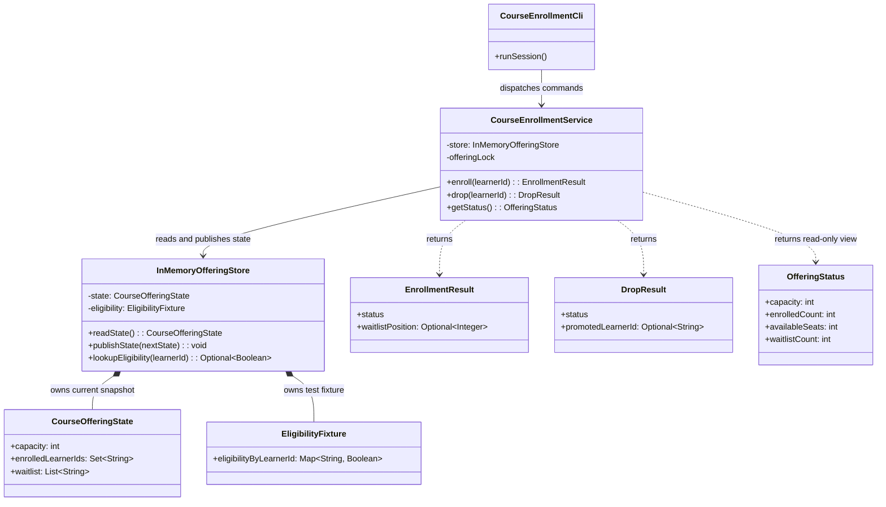

# Low-Level Design: Initial Domain Model

## Scope

This LLD follows [`requirement.md`](../requirement.md), the selected in-process Java CLI approach in [`architecture-options.md`](architecture-options.md), and the approved three-component architecture in [`HLD.md`](HLD.md). It records domain types, detailed operation pseudocode, and state-transition behavior without implementation code or tests.

The runtime remains three components: interactive CLI, enrollment service, and in-memory offering store. Domain state and result records below are data types, not additional services or architectural components.

## Proposed Class Diagram



The queue is a list of learner IDs. Appending while the service holds the offering lock defines accepted FIFO order; no timestamp or separate queue manager is needed. The current position is derived from the list order. The eligibility fixture represents whether each known learner satisfies the prerequisite rule; tests can change fixture values without adding CLI commands.

## Responsibility Table

| Type | Responsibility and dependencies | Essential? |
|---|---|---|
| `CourseEnrollmentCli` | Runs the interactive session, parses enroll/drop/status commands and learner IDs, calls the service, and displays its result. Malformed input produces a validation error and the session continues. It owns no enrollment state or business rules. | Yes; required user interface. |
| `CourseEnrollmentService` | Validates learner IDs at its boundary and owns enrollment/drop rules: duplicate handling, known-learner and eligibility checks, capacity decisions, FIFO queue operations, promotion policy, read-only status mapping, and result creation. Holds the per-offering lock across state read, decision, and publication. Depends on the store. | Yes; sole owner of business rules. |
| `InMemoryOfferingStore` | Owns the current offering snapshot and the eligibility fixture. Provides controlled state reads, complete state replacement, and eligibility lookup. It makes no business decisions. | Yes; required in-memory state owner. |
| `CourseOfferingState` | Immutable snapshot of positive capacity, enrolled learner IDs, and ordered waitlist learner IDs. Starts with an empty enrollment and waitlist; the CLI demo initializes capacity 3. Tests can initialize other capacities. | Yes; keeps related offering state together for atomic replacement. |
| `EligibilityFixture` | Small in-memory mapping from learner ID to prerequisite eligibility. The store owns it; tests may change eligibility values only between completed service operations, without adding CLI commands. Known IDs remain present while eligibility changes. | Yes as data per the approved HLD; a named wrapper type is optional if a map in the store is clearer. |
| `EnrollmentResult` | Carries `ENROLLED`, `ALREADY_ENROLLED`, `WAITLISTED`, `ALREADY_WAITLISTED`, `INELIGIBLE`, `UNKNOWN_LEARNER`, `INVALID_REQUEST`, or `INTERNAL_ERROR`; includes the one-based waitlist position for waitlisted outcomes. | Yes as an explicit result contract; exact enum/record shape is flexible. |
| `DropResult` | Carries `DROPPED`, `NOT_ENROLLED`, `UNKNOWN_LEARNER`, `INVALID_REQUEST`, or `INTERNAL_ERROR`, plus an optional promoted learner ID. | Yes as an explicit result contract; exact enum/record shape is flexible. |
| `OfferingStatus` | Read-only aggregate view with capacity, enrolled count, available seats, and waitlist count. It contains no mutable collections or learner eligibility data. | Included as requested; not an assignment acceptance requirement. |
| `LearnerId` value record | Could wrap and validate learner identifiers at the CLI/service boundary. | Optional; plain strings are sufficient for this small assignment. |
| `WaitlistEntry` record | Could carry a learner ID plus future queue metadata. | Optional; a `List<String>` already preserves FIFO and supports position lookup. |

There is no separate `Learner` entity because the application does not manage learner profiles. There is also no separate promotion service, prerequisite policy engine, repository abstraction, or transaction framework.

## State and Rule Ownership

`InMemoryOfferingStore` is the owner of application state: the `CourseOfferingState` snapshot and the small eligibility fixture. The store is initialized with one predefined offering, positive capacity, and no enrolled or waitlisted learners. Its sample CLI initialization uses capacity 3; test setup may use other positive capacities.

`CourseEnrollmentService` is the sole owner of business rules and the offering lock. The CLI owns only the active input/output session. The service is responsible for preserving these state properties:

- Enrolled learner count does not exceed capacity.
- A learner has at most one active enrollment or waitlist entry.
- New enrollment and waitlisting require prerequisite eligibility; promotion rechecks current fixture eligibility.
- Repeated enrollment requests return the existing active state; a repeated waitlist request returns the current position.
- Waitlist list order represents accepted-request FIFO order. An ineligible learner is skipped for a promotion but remains in the same relative position.
- A dropped learner who requests again is a fresh request and joins the end of the waitlist if the offering is full.
- If no eligible learner can be promoted, the dropped seat remains open.
- A failed operation does not publish partially updated state.

## Collaboration

1. The CLI remains active for multiple commands, validates command syntax, and dispatches each valid enrollment or drop request to the service.
2. The service acquires the offering lock before reading any state used for a decision. For an enrollment request, it first returns existing enrollment or waitlist state for a duplicate; otherwise it checks fixture eligibility and capacity and prepares the result.
3. For a drop, the service validates the active enrollment, prepares the drop and any promotion together, and checks waitlisted learners in list order using the current eligibility fixture. It retains skipped ineligible entries in order and leaves the seat open if no candidate qualifies.
4. For a successful mutation, the service creates a complete next `CourseOfferingState` and asks the store to publish it once. Duplicate, ineligible, or invalid no-change outcomes publish no state.
5. The service releases the lock in a `finally`-style guarantee before returning a result or propagating failure. The CLI displays the result after publication; an output failure does not roll back committed state.

The state snapshot should be treated as immutable after publication. This allows the service to prepare a candidate without exposing intermediate collection changes. The single service lock serializes overlapping calls within this process; it does not coordinate multiple processes, which are outside the approved design.

## Business Validation and Edge-Case Matrix

### Trace labels and invariant IDs

- **[Assignment]** Behavior stated in `requirement.md`. `FR1` through `FR5` refer, in order, to its five functional requirements.
- **[Approved]** Behavior selected in `requirement.md`, the approved `docs/HLD.md`, or the explicit decisions recorded in this LLD.
- **[Open]** The input documents do not determine the behavior; approval is needed before fixing the result contract.
- **[Optional]** Additional defensive behavior, not required by the assignment.

The following invariants apply after every published state transition:

- **I1 Capacity:** Capacity is positive; enrolled count never exceeds capacity. An open seat is valid when no eligible waitlisted learner can be promoted.
- **I2 Exclusive membership:** A learner appears in at most one active state: enrolled or waitlisted. Duplicate requests add no membership.
- **I3 Eligibility:** A new enrollment, new waitlist entry, or promotion requires current prerequisite eligibility.
- **I4 FIFO:** Waitlist entries retain accepted-request order. Appending a new request adds it at the end; skipping an ineligible entry does not change its relative position.
- **I5 Atomicity:** A state-changing operation publishes one complete next snapshot or leaves the prior snapshot unchanged. No intermediate drop, enrollment, or queue mutation is visible.
- **I6 No-change outcomes:** Invalid, ineligible, duplicate, or failed operations do not publish a changed snapshot, except duplicate operations return the existing state.
- **I7 Lock lifecycle:** The offering lock serializes each service operation and is released on every return or failure path.

### Initialization and CLI input

| Scenario; preconditions and input | Validation | Expected result | State change? | Basis; relevant criterion or invariant |
|---|---|---|---|---|
| Initialize the sample offering with capacity 3, or a test offering with another positive capacity. | Validate that capacity is positive; start with no enrolled learners and an empty waitlist. | One offering is available with the configured capacity. | Yes, initial state is created; no memberships are created. | [Approved] HLD initialization decision; I1. |
| Initialize with capacity zero or negative. | Reject initialization because it violates the approved positive-capacity requirement. | Initialization fails clearly; no usable offering state is published. Exact startup error format is not specified. | No valid application state is created. | [Approved] positive capacity; I1. Exact error presentation is an implementation detail. |
| Malformed CLI input: unsupported command, missing learner ID, or malformed arguments. | CLI validates syntax and required arguments before calling the service. | Display a clear validation error, then continue the interactive session. No business operation is invoked. | No. | [Assignment] FR5 invalid requests; [Approved] CLI validation and continue-session decision; I6. |

### Enrollment, waitlisting, duplicates, and prerequisites

| Scenario; preconditions and input | Validation | Expected result | State change? | Basis; relevant criterion or invariant |
|---|---|---|---|---|
| New known, eligible learner requests enrollment while a seat is available. | Under the lock, check active membership first; for a new request, check fixture eligibility, then capacity. | Return enrolled. | Add learner to enrolled set and publish once. | [Assignment] FR1; [Approved] capacity-first enrollment; I1-I3, I5, I7. |
| New known, eligible learner requests enrollment when full. | Check active membership, eligibility, then available capacity. | Return waitlisted with the newly assigned position. | Append exactly one entry at the end of the waitlist and publish once. | [Assignment] FR2; [Approved] accepted-request FIFO; I2-I5, I7. |
| Learner is already enrolled and repeats enrollment after their fixture eligibility changes to ineligible. | Check active membership before prerequisite eligibility for a new request. | Return the existing enrollment state; do not retroactively remove the active enrollment. | No. | [Approved] HLD duplicate-before-new-eligibility flow and duplicate-state decision; I2, I6. Eligibility is rechecked for promotion, not continuously for enrolled learners. |
| Learner is already waitlisted and repeats enrollment after their fixture eligibility changes to ineligible. | Check active membership before new-request eligibility; find the existing waitlist entry and its current position. | Return existing waitlist position. Recheck eligibility only if considered for promotion. | No; do not add, remove, or reorder the entry. | [Approved] duplicate waitlist result and promotion-time recheck; I2, I4, I6. |
| New known learner is in the fixture but currently ineligible. | For a learner with no active membership, check current eligibility before capacity handling. | Reject as ineligible; do not enroll or waitlist, even if a seat is open. | No. | [Assignment] FR1, FR2, FR4; [Approved] prerequisite rule; I3, I6. |
| Learner ID is absent from the eligibility fixture and has no active membership. | Check fixture membership separately from the learner's eligibility value. | Return `UNKNOWN_LEARNER`, distinct from a known learner whose eligibility value is false. | No. | [Approved] Unknown-learner decision; I3, I6. |
| Same learner submits concurrent or repeated enrollment requests. | Serialize requests under the offering lock; the later request sees the first request's published membership. | One active membership only. A later request returns existing enrolled state or waitlist position. | The first accepted request may change state; duplicates do not. | [Assignment] FR2; [Approved] duplicate behavior and in-process lock; I2, I5, I7. |
| A learner was dropped successfully and later requests enrollment again. | Confirm no active enrollment or waitlist membership, then check current eligibility and capacity as for a new request. | Enroll if a seat is available; otherwise add at the current waitlist tail. | Yes if eligible; the new waitlist entry, if needed, gets a fresh position. | [Approved] fresh-request decision; [Assignment] FR1-FR2; I1-I4. |
| A successful drop left an open seat because every waiter was ineligible; a new eligible learner requests enrollment. | Apply the normal new-request checks. Do not trigger promotion or rescan the waitlist outside a successful drop. | Enroll the new eligible learner in the open seat. A retained learner who becomes eligible later may remain waiting until a later successful drop. | Yes, add the new learner to enrollment; waitlist order is unchanged. | [Assignment] FR1; [Approved] promotion only on successful drop and no rescan before new enrollment; I1-I4. This is a documented limitation, not an automatic promotion trigger. |

### Drop, promotion, and FIFO behavior

| Scenario; preconditions and input | Validation | Expected result | State change? | Basis; relevant criterion or invariant |
|---|---|---|---|---|
| Valid drop; waitlist has eligible learners, possibly preceded by ineligible entries. | Under one lock, verify enrolled membership; build candidate state; scan waitlist in FIFO order and check current eligibility. | Drop learner; promote the earliest currently eligible entry. Skip ineligible entries but retain their original relative order. | Publish one snapshot removing the dropped learner and promoted learner from the queue, adding the promotee to enrollment, and retaining all other entries in order. | [Assignment] FR3-FR4; [Approved] skip-but-retain policy; I1-I5, I7. |
| Eligibility changes after a learner joined the waitlist but before a drop triggers promotion. | Re-evaluate the learner against the current fixture during the promotion scan, not the value from queue entry time. | Promote if currently eligible and first eligible in FIFO scan; otherwise skip and retain in place. | On promotion, update enrollment and queue in the single drop transition; if skipped, preserve membership and ordering. | [Assignment] FR3-FR4; [Approved] promotion-time eligibility check; I3-I5. |
| Valid drop; all remaining waitlisted learners are currently ineligible or the queue is empty. | Verify enrollment, scan the complete queue, and find no eligible candidate. | Drop succeeds; leave the seat open and retain all ineligible entries in order. | Remove dropped learner; no promotion. | [Approved] no-eligible outcome; [Assignment] FR3-FR4; I1, I4-I6. |
| A known learner is not enrolled, including a repeated drop. | Check active enrollment membership before building a candidate state. | Return `NOT_ENROLLED` as a clear no-change result. Do not remove a waitlist entry as part of drop. | No. | [Assignment] FR5; [Approved] invalid/repeated drop decision; I2, I6. |
| An unknown learner ID is submitted to drop and is not enrolled. | Check enrollment membership, then check whether the ID exists in the eligibility fixture. | Return `UNKNOWN_LEARNER`; do not change state. | No. | [Approved] unknown-learner decision and distinct drop result; I2, I6. |
| Waitlist promotion scans past one or more ineligible entries. | Preserve source order while identifying the first currently eligible learner; do not delete or move skipped entries. | Promote the earliest eligible learner; skipped learners keep their relative positions. | Publish only the selected promotion and drop; the relative order of remaining waitlist entries is unchanged. | [Assignment] FR3-FR4; [Approved] FIFO and skip-but-retain decisions; I2, I4-I5. |
| Prerequisite evaluation fails during promotion after preparing a candidate drop/promotion. | Keep edits in the candidate snapshot; discard the complete candidate if evaluation fails. | Return `INTERNAL_ERROR` without technical details; release the lock. Do not report the drop or promotion as successful. | No; original enrollment and waitlist snapshot remains. | [Approved] internal-error and atomicity decisions; [Assignment] FR5; I5-I7. |

### Concurrency and failure handling

| Scenario; preconditions and input | Validation | Expected result | State change? | Basis; relevant criterion or invariant |
|---|---|---|---|---|
| Two eligible, distinct learners concurrently request the final available seat. | Hold one offering lock across state read, eligibility/capacity decision, and publication. | One request enrolls; the other observes full capacity and joins the waitlist once. Enrolled count never exceeds capacity. Which request wins is determined by lock/acceptance order. | Yes, both requests may change state in serialized order. | [Approved] HLD lock and accepted-order decision; [Assignment] FR1-FR2; I1-I5, I7. |
| Prerequisite evaluation fails unexpectedly for a new enrollment/waitlist request. | Do not convert an evaluation failure into successful eligibility; publish only after evaluation and candidate preparation complete. | Return `INTERNAL_ERROR` without technical details and release the lock. | No. | [Approved] internal-error and atomicity decisions; I5-I7. |
| Prerequisite evaluation fails during promotion after a learner drop has been staged. | Discard the whole candidate transition; do not publish the staged removal or any partial queue scan result. | Return `INTERNAL_ERROR` without technical details; original enrollment and waitlist are preserved, and lock is released. | No. | [Approved] failure-atomic drop/promotion and internal-error decisions; I5-I7. |
| State publication succeeds, then CLI output fails. | Treat store publication as the commit point; output occurs after the service returns. | State remains committed; CLI output failure does not roll back enrollment, drop, or promotion. The user may not receive confirmation. | Yes, according to the already-published operation. | [Approved] HLD post-publication output decision; I5. |
| Failure before publication on any state-changing operation. | Construct candidate state without mutating the published snapshot; publish once only after the operation is complete. | Propagate or report failure and release the lock; published state remains as before. | No. | [Approved] HLD snapshot/try-finally model; I5-I7. |

## Validation Order by Operation

### Enroll

1. CLI validates command syntax and required learner ID. Malformed input does not call the service.
2. Service acquires the offering lock and reads the current offering snapshot.
3. Check active membership first. If enrolled, return `ALREADY_ENROLLED`; if waitlisted, return `ALREADY_WAITLISTED` with its current position. These duplicate paths do not recheck eligibility or publish state, even if a known learner's eligibility changed.
4. For a new request, check whether the learner ID exists in the fixture. If absent, return `UNKNOWN_LEARNER`; this differs from a known learner with a false eligibility value.
5. Evaluate the prerequisite. If false, return `INELIGIBLE`; if evaluation fails, return `INTERNAL_ERROR` without technical details. Both outcomes leave the published state unchanged.
6. Check capacity. If available, prepare enrollment. If full, append one waitlist entry at the tail. Do not rescan or promote the current waitlist during enrollment.
7. Publish the complete candidate snapshot once for a successful mutation. Return the result and release the lock in `finally`; any failure before publication preserves current state.

### Drop and promotion

1. CLI validates command syntax and required learner ID. Malformed input does not call the service.
2. Service acquires the offering lock and reads the current snapshot.
3. If learner is not enrolled, check fixture membership: absent means `UNKNOWN_LEARNER`; present means `NOT_ENROLLED`. Return without changing state. An enrolled learner may drop regardless of current prerequisite eligibility.
4. Build a candidate snapshot with the enrollment removed. Scan waitlist entries in FIFO order, checking current eligibility for each. Retain skipped entries in their original relative order; stop at the first eligible learner and prepare that promotion.
5. If no eligible learner exists, finish the drop candidate with the seat open. If prerequisite evaluation fails, discard the entire candidate and return `INTERNAL_ERROR` without technical details.
6. Publish the complete candidate snapshot once, then return `DROPPED` and release the lock in `finally`. Output failure after service return does not undo publication.

### Get status

1. CLI validates the status command; malformed input is rejected without a service call.
2. Service acquires the offering lock, reads the current immutable snapshot, and creates `OfferingStatus` from capacity and collection sizes.
3. Return the aggregate view without eligibility evaluation, promotion, or state publication.
4. Release the lock in `finally` before returning.

## Invariants After Every Successful Transition

Every published state must satisfy I1-I7 above. More explicitly:

- Capacity remains positive and enrollment count is at most capacity; a successful drop can leave an open seat if no candidate qualifies.
- No learner is both enrolled and waitlisted, and neither collection contains duplicate learner membership.
- Every newly enrolled, newly waitlisted, or promoted learner has current eligibility established at the corresponding operation.
- Waitlist order changes only by appending an accepted new request or removing a promoted learner; scanning and skipping never reorders entries.
- A drop plus any promotion is committed as one complete snapshot. Invalid, duplicate, ineligible, or failed operations preserve the current snapshot.
- The offering lock is released before returning a result or propagating failure.

## Detailed Operation Algorithms

The pseudocode describes behavior only. The runtime remains the CLI, `CourseEnrollmentService`, and `InMemoryOfferingStore`. Both CLI and service validate learner IDs; the service check rejects null, blank, or whitespace-containing values before state access. The store publishes immutable `CourseOfferingState` snapshots; the service prepares a private candidate and complete result before publication. `publishState` performs one atomic reference replacement and has no potentially failing work after the replacement. `INTERNAL_ERROR` therefore means failure before commit; post-commit output errors are presentation failures, not uncommitted service outcomes.

### Enrollment

```text
ENROLL(learnerId)
    CLI validates command shape and required ID syntax.
    If malformed: display a validation error, continue the session, and do not call the service.

    service validates learnerId is non-null, nonblank, and contains no whitespace
    if invalid:
        return INVALID_REQUEST

    acquire offering lock
    try:
        current = store.readState()

        if learnerId is in current.enrolledLearnerIds:
            return ALREADY_ENROLLED

        position = indexOf(learnerId, current.waitlist)
        if position exists:
            return ALREADY_WAITLISTED(position + 1)

        if learnerId is absent from eligibility fixture:
            return UNKNOWN_LEARNER

        try:
            eligible = evaluate prerequisite using current fixture value
        catch prerequisite-evaluation failure:
            return INTERNAL_ERROR without technical details

        if not eligible:
            return INELIGIBLE

        candidate = private copy of current state
        if size(candidate.enrolledLearnerIds) < candidate.capacity:
            add learnerId to candidate.enrolledLearnerIds
            result = ENROLLED
        else:
            append learnerId to candidate.waitlist
            result = WAITLISTED(position = size(candidate.waitlist))

        store.publishState(candidate)  // one complete snapshot replacement
        return result
    finally:
        release offering lock
```

Membership lookup precedes fixture and prerequisite checks. Thus an existing enrollment or waitlist entry is returned even if the known learner's eligibility later changes. For a new request, fixture absence returns `UNKNOWN_LEARNER`; a present false value returns `INELIGIBLE`. Enrollment does not scan or promote existing waitlist entries, even if a seat is open. Promotion is triggered only by a successful drop.

### Drop and promotion

```text
DROP(learnerId)
    CLI validates command shape and required ID syntax.
    If malformed: display a validation error, continue the session, and do not call the service.

    service validates learnerId is non-null, nonblank, and contains no whitespace
    if invalid:
        return INVALID_REQUEST

    acquire offering lock
    try:
        current = store.readState()

        if learnerId is not in current.enrolledLearnerIds:
            if learnerId is absent from eligibility fixture:
                return UNKNOWN_LEARNER
            return NOT_ENROLLED

        candidate = private copy of current state
        remove learnerId from candidate.enrolledLearnerIds
        promotedLearnerId = none

        for waitlistedLearnerId in current.waitlist, from first to last:
            try:
                eligible = evaluate prerequisite using current fixture value
            catch prerequisite-evaluation failure:
                discard candidate
                return INTERNAL_ERROR without technical details

            if not eligible:
                retain this entry in its original relative position
                continue

            add waitlistedLearnerId to candidate.enrolledLearnerIds
            remove only this entry from candidate.waitlist
            promotedLearnerId = waitlistedLearnerId
            stop scanning

        // If no eligible learner was found, keep the seat open.
        result = DROPPED(promotedLearnerId)
        store.publishState(candidate)  // one atomic reference replacement; commit point
        return result
    finally:
        release offering lock
```

The scan evaluates eligibility at promotion time. Ineligible entries are skipped for this promotion and remain in their original relative order. If no eligible entry exists, the successful drop removes the enrolled learner and leaves a seat open. A learner who becomes eligible afterward can remain on the waitlist until a later successful drop; no eligibility-change trigger or pre-enrollment rescan is performed. If evaluation fails during the scan, the entire candidate is discarded, so neither the drop nor a partial promotion is committed.

### Read-only status

```text
GET_STATUS()
    acquire offering lock
    try:
        current = store.readState()
        return OfferingStatus(
            capacity = current.capacity,
            enrolledCount = size(current.enrolledLearnerIds),
            availableSeats = current.capacity - size(current.enrolledLearnerIds),
            waitlistCount = size(current.waitlist)
        )
    finally:
        release offering lock
```

Status returns aggregate counts only. It does not publish state, inspect eligibility, or trigger promotion. This read-only CLI/service query is included at the user's request; it is not a functional acceptance requirement in `requirement.md`.

## State-Transition Tables

### Enrollment

| Preconditions | Outcome | State change |
|---|---|---|
| Learner already enrolled, regardless of changed eligibility | `ALREADY_ENROLLED` | None |
| Learner already waitlisted, regardless of changed eligibility | `ALREADY_WAITLISTED` with current position | None |
| No active membership; learner absent from eligibility fixture | `UNKNOWN_LEARNER` | None |
| No active membership; known learner is ineligible | `INELIGIBLE` | None |
| Known, eligible learner; seat available | `ENROLLED` | Add to enrollment; publish one candidate snapshot |
| Known, eligible learner; offering full | `WAITLISTED` with tail position | Append to waitlist; publish one candidate snapshot |
| Prerequisite evaluation fails | `INTERNAL_ERROR` | None; do not publish candidate |

### Drop and promotion

| Preconditions | Outcome | State change |
|---|---|---|
| Learner absent from enrollment and eligibility fixture | `UNKNOWN_LEARNER` | None |
| Known learner absent from enrollment | `NOT_ENROLLED` | None |
| Learner enrolled; first currently eligible waiter found | `DROPPED` with promoted learner ID | Remove dropped learner, promote earliest eligible waiter, remove only that waiter from queue, publish once |
| Learner enrolled; no eligible waiter found | `DROPPED` without promoted learner ID | Remove dropped learner; retain all waiters in order; one seat remains open |
| Prerequisite evaluation fails during promotion | `INTERNAL_ERROR` | None; discard entire candidate state |

### Status and CLI validation

| Preconditions | Outcome | State change |
|---|---|---|
| Valid status command | Return capacity, enrolled count, available seats, and waitlist count | None |
| Malformed or unsupported command | Display validation error and continue the interactive session; do not call service | None |

## Locking, Publication, and Failure Atomicity

- The service acquires the single offering lock before reading state and holds it through validation, candidate construction, and publication. Concurrent final-seat enrollments are serialized: one eligible request can enroll; the next observes the full offering and joins the waitlist. The order follows the order in which requests acquire the lock.
- `CourseOfferingState` and its collection contents are immutable after publication. The service copies the enrolled set and ordered waitlist into a private candidate; it never edits published collections in place.
- Publication replaces the store's current snapshot once. A failure before replacement discards the candidate and preserves the entire prior state. Drop and promotion are never published as separate mutations.
- Every service operation, including no-change outcomes and status retrieval, releases the lock in a `finally`-style guarantee before returning. The CLI displays results after the service returns; output failure does not roll back a published operation.
- The fixture retains known learner IDs while tests change their eligibility values between service calls. Missing ID is `UNKNOWN_LEARNER`; an unexpected evaluation failure is `INTERNAL_ERROR`, preserves offering state, releases the lock, and exposes no technical details to CLI output.

## Complexity

Let `E` be the number of enrolled learners and `W` the number of waitlist entries. Enrolled membership uses a hash set and eligibility uses a map, so those lookups are expected O(1). The waitlist is an ordered list, so membership/position lookup is O(W). Every successful mutation copies a complete immutable state snapshot, costing O(E + W).

| Operation | Complexity | Reason |
|---|---:|---|
| New enrollment request | O(E + W) worst case | Waitlist uniqueness check is O(W); candidate copy is O(E + W). Hash set and fixture lookups are expected O(1). |
| Duplicate enrolled request | O(1) expected | Enrolled set lookup; no copy or publication. |
| Duplicate waitlist request / waitlist position lookup | O(W) | Scan the ordered list to find the learner and current one-based position. |
| Append to waitlist | O(1) amortized after validation | List append is amortized O(1); overall enrollment still includes O(W) uniqueness lookup and O(E + W) candidate copy. |
| Drop with no promotion candidate | O(E + W) | Copy the state; enrollment membership check is expected O(1). |
| Drop with promotion | O(E + W) | Candidate copy costs O(E + W), and the eligibility scan checks at most W entries. |
| Promotion scan | O(W) | At most every waitlist entry is checked. |
| Read-only status retrieval | O(1) | Reads collection sizes and capacity; returns aggregate values without copying collections. |

An auxiliary waitlist-position map could reduce duplicate lookup from O(W), but duplicates queue state and creates another consistency invariant. It is optional hardening and is not recommended for this assignment's scale.

## Requirement Alignment and Remaining Review

The enrollment, waitlisting, dropping, FIFO promotion, prerequisite checks, duplicate handling, capacity bound, and failure-atomic state transition align with `requirement.md` and the approved decisions. No direct contradiction was found. Promotion is deliberately triggered only by a successful drop. Consequently, a learner who becomes eligible after being skipped can remain waiting until a later successful drop, and a new eligible enrollment request may use an already-open seat without a queue rescan, as explicitly decided.

The aggregate `getStatus` view was requested for this LLD but is not required by the assignment acceptance criteria. Additional abstractions such as a `LearnerId` value type, a waitlist-position index, or a dedicated eligibility policy are optional and omitted from the minimal model. No implementation code or tests are introduced by this design.

## CLI Contract

The CLI is interactive and accepts one command per input line. Command words are the exact lowercase tokens shown below. The CLI initializes one empty offering at capacity 3, then continues until `exit` or an unrecoverable input/output failure.

| Command | Argument format | Behavior |
|---|---|---|
| `enroll <learnerId>` | Exactly one learner ID token. | Call `CourseEnrollmentService.enroll`. |
| `drop <learnerId>` | Exactly one learner ID token. | Call `CourseEnrollmentService.drop`. |
| `status` | No arguments. | Call `getStatus`; display capacity, enrolled count, available seats, and waitlist count. |
| `help` | No arguments. | Display the supported commands and argument forms below. |
| `exit` | No arguments. | Display `Goodbye.` and end the interactive session. |

A learner ID is one non-whitespace token, matched exactly and case-sensitively against the eligibility fixture. Null, blank, or whitespace-containing values are `INVALID_REQUEST` at the service boundary. The CLI validates the same rule before dispatch. No further character restrictions or normalization are applied. A syntactically valid ID absent from the fixture is `UNKNOWN_LEARNER`, not `INVALID_REQUEST` or `INELIGIBLE`.

Blank lines, unknown command words, missing or extra arguments, and malformed IDs produce `INVALID_REQUEST`, display a clear validation message, do not call business logic for CLI-detected errors, and leave the interactive session running. `help`, `status`, and `exit` with extra arguments are malformed input. Service-level ID validation remains in place for calls that bypass the CLI.

### Result and display contract

| Outcome | CLI display |
|---|---|
| `ENROLLED` | `ENROLLED: <learnerId> is enrolled.` |
| `ALREADY_ENROLLED` | `ALREADY_ENROLLED: <learnerId> is already enrolled.` |
| `WAITLISTED` | `WAITLISTED: <learnerId> joined at position <n>.` |
| `ALREADY_WAITLISTED` | `ALREADY_WAITLISTED: <learnerId> is already waitlisted at position <n>.` |
| `DROPPED` with promotion | `DROPPED: <learnerId> dropped; <promotedLearnerId> was promoted.` |
| `DROPPED` without promotion | `DROPPED: <learnerId> dropped; no eligible learner was available, so the seat is open.` |
| `NOT_ENROLLED` | `NOT_ENROLLED: <learnerId> has no active enrollment.` |
| `UNKNOWN_LEARNER` | `UNKNOWN_LEARNER: <learnerId> is not in the learner eligibility fixture.` |
| `INELIGIBLE` | `INELIGIBLE: <learnerId> does not satisfy the prerequisite.` |
| `INVALID_REQUEST` | `INVALID_REQUEST: Invalid command, arguments, or learner ID. Type help for command formats.` |
| `INTERNAL_ERROR` before publication | `INTERNAL_ERROR: The operation failed before commit; no state was changed.` No exception, fixture, or implementation details are shown. |

For `status`, display a compact report with `Capacity`, `Enrolled`, `Available seats`, and `Waitlisted` counts. For `help`, display:

```text
enroll <learnerId>  Enroll an eligible learner or join the waitlist.
drop <learnerId>    Drop an enrollment and promote the first eligible waiter.
status              Show capacity and enrollment/waitlist counts.
help                Show command formats.
exit                End the session.
```

If output fails after a state-changing result (`ENROLLED`, `WAITLISTED`, or `DROPPED`) has been published, the CLI must not relabel the operation as an uncommitted `INTERNAL_ERROR` or automatically retry it. Report `OUTPUT_ERROR: The operation was committed, but its result could not be displayed.` when an error channel remains available; otherwise stop the session. If output fails after a no-change result or `status`, report `OUTPUT_ERROR: No state change was made; the result could not be displayed.` when possible. Output errors are presentation failures, not service outcomes. Published in-memory state remains committed while the process is running.

### Sample interactive session

Assume the fixture contains `learner-a`, `learner-b`, `learner-c`, and `learner-d`, each currently eligible. The offering starts empty with capacity 3.

```text
> help
enroll <learnerId>  Enroll an eligible learner or join the waitlist.
drop <learnerId>    Drop an enrollment and promote the first eligible waiter.
status              Show capacity and enrollment/waitlist counts.
help                Show command formats.
exit                End the session.

> enroll learner-a
ENROLLED: learner-a is enrolled.
> enroll learner-b
ENROLLED: learner-b is enrolled.
> enroll learner-c
ENROLLED: learner-c is enrolled.
> enroll learner-d
WAITLISTED: learner-d joined at position 1.
> status
Capacity: 3
Enrolled: 3
Available seats: 0
Waitlisted: 1
> drop learner-b
DROPPED: learner-b dropped; learner-d was promoted.
> status
Capacity: 3
Enrolled: 3
Available seats: 0
Waitlisted: 0
> exit
Goodbye.
```

## Approved Clarifications

- Eligibility fixture entries remain present; tests change only their eligible/ineligible values, and only between completed service operations. No CLI command modifies eligibility.
- The service validates learner IDs as well as the CLI. Invalid syntax is `INVALID_REQUEST`; a valid ID absent from the fixture is `UNKNOWN_LEARNER`; a known false eligibility value is `INELIGIBLE`.
- `publishState` performs a single atomic reference replacement and no potentially failing work after the replacement. The service prepares its result before publication. Failures before replacement preserve the original snapshot; after replacement, the operation is committed and must not be reported as uncommitted.
- Malformed CLI input produces a validation error, invokes no business operation, and does not end the interactive session.

These clarifications do not change the approved three-component architecture. The only assignment-scope addition is the requested read-only `status` command; it does not mutate state or trigger promotion. No unresolved decision currently blocks implementation.
